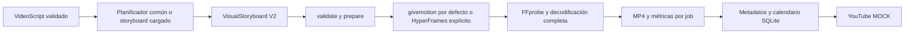

# Fase 3: render nativo dentro de la fábrica

`fabrica produce` y `fabrica cycle` usan givemotion para trabajos nuevos. Son los comandos existentes de la aplicación Python, no un runner experimental. `Factory` conserva SQLite, catálogo, calendario, metadatos y el publicador exclusivamente MOCK. La máquina de estados del publicador y el cliente permitido no se modificaron; su frontera de QA ahora admite videos nativos sin pista de audio y vuelve a decodificarlos.



## Dependencias y provisión

Python sigue usando las dependencias del proyecto. Los binarios Node y Chrome y cada paquete JS viven en `.renderers/`, ignorado por Git. Paquetes y lockfiles aprobados están incluidos en `src/fabrica/renderers/locks/`; el runtime conservado es Node 22.16.0 y Chrome headless shell 157.0.8103.78. Motores: givemotion 0.1.6; HyperFrames 0.9.59 con GSAP 3.15.0. FFmpeg/FFprobe y DejaVu Sans del sistema se reutilizan.

En este repositorio ya existe la caché fijada por el A/B. Promover solo el motor elegido, sin red ni instalación global:

```bash
.venv/bin/python -m fabrica.cli renderer provision --engine givemotion --runtime-root .renderers --source experiments/renderer_ab/engines
.venv/bin/python -m fabrica.cli renderer status --engine givemotion
```

El argumento `--source` es una caché local explícita y puede tener otra ubicación. El código productivo **no importa experiments ni ejecuta sus runners**. Se copian únicamente Node, Chrome, bibliotecas y el motor seleccionado. HyperFrames no es obligatorio para usar givemotion. La misma operación con `--engine hyperframes` instala explícitamente el alternativo. No hay npm install automático, descargas, fallback ni cambios silenciosos de versión. La provisión es offline desde una caché previamente instalada; el aprovisionamiento desde cero en otra plataforma queda fuera de esta migración Linux/WSL.

## Uso

Trabajo silencioso desde un guion local; el storyboard se planifica dentro del pipeline:

```bash
.venv/bin/python -m fabrica.cli produce --mode local --topic 'Costo de oportunidad' --script src/fabrica/data/costo_oportunidad.json --job-id oportunidad --output out/jobs
```

Con un storyboard ya planificado, conservando narrativa y tiempos:

```bash
.venv/bin/python -m fabrica.cli produce --mode local --topic '¿Por qué no te queda dinero a fin de mes?' --script src/fabrica/data/budget_55_script.json --storyboard src/fabrica/data/budget_55_storyboard.json --job-id presupuesto-55 --output out/jobs
```

`examples/renderer_givemotion.json` y `examples/renderer_hyperframes.json` contienen configuraciones equivalentes salvo el motor. Ejemplo de selección explícita sin cambiar guion ni storyboard:

```bash
.venv/bin/python -m fabrica.cli produce --mode local --topic 'Costo de oportunidad' --script src/fabrica/data/costo_oportunidad.json --storyboard src/fabrica/data/opportunity_storyboard.json --renderer-config examples/renderer_hyperframes.json --job-id oportunidad-hf --output out/jobs
```

`--renderer hyperframes` también selecciona el motor. Las opciones CLI prevalecen sobre el archivo de configuración. `scene_seconds` configura la planificación automática; un storyboard cargado conserva sus propios intervalos y FPS. La resolución CLI debe coincidir con la del storyboard. Los perfiles generados usan 1080×1920 y 24 FPS por defecto. Las duraciones pertenecen a la planificación visual, no a audio simulado. `--mock-seconds` y los estilos antiguos de subtítulos se conservan para el renderer legado; los nativos muestran la narración del storyboard y generan un SRT auxiliar.

Ciclo de fábrica con calendario, contenido distinto del presupuesto y publicación solo simulada:

```bash
.venv/bin/python -m fabrica.cli cycle --db out/factory/state.sqlite3 --config examples/schedule_mock.json --output out/factory --at 2026-11-18T16:00:00+00:00 --script src/fabrica/data/costo_oportunidad.json --storyboard src/fabrica/data/opportunity_storyboard.json
```

El catálogo aporta el slot/tema de trabajo; un guion local explícito aporta el contenido validado y los metadatos extractivos. No se modifica su narración. `--fault uncertain` ejercita la reconciliación MOCK; repetir con un reloj posterior y los mismos parámetros recupera el trabajo. No permite un segundo upload simulado para el mismo intento ya conciliado.

## Contrato y adaptadores

`VisualStoryboard` conserva la lectura V1 para los tests y resultados A/B. Los trabajos productivos usan V2: identidad, escenas/títulos, elementos, datos referenciados, eventos, anclajes narrativos, intervalos, safe area, colores y tipografía. No exige presupuestos ni siete escenas. Los totales cuantitativos opcionales comprueban sumas exactas con Decimal; el fixture de 55 s verifica ambas distribuciones de ARS 1.200.000. El ejemplo no aparece como constantes financieras dentro de JS.

`visual_planner.py` toma una única decisión editorial compartida: interpreta los tipos/datos del VideoScript y produce el plan. Un storyboard cargado se valida contra el guion: mismo título, número de escenas y narración. Los adaptadores no inventan títulos, cifras, mensajes o intervalos. `components.js` contiene componentes vectoriales y evaluación pura del estado por tiempo. givemotion usa secuencias y gm.onFrame; HyperFrames usa subcomposiciones y el reloj de una timeline GSAP. Compartir primitivas y planificación en producción evita duplicar reglas editoriales; los experimentos comparativos independientes se preservan sin modificaciones.

Interfaz interna: `validate(storyboard, audio)`, `prepare(storyboard, directory, audio)`, `render(prepared, audio)` e `inspect(video, storyboard, directory, audio)`. `RenderProduct` retorna video, thumbnail, métricas e inspección. El pipeline promueve únicamente un resultado inspeccionado. Ver [componentes](PHASE3_COMPONENTS.md).

## Reanudación y seguridad

Cada job tiene lock, configuración inmutable y hashes por etapa. Cada intento nativo tiene un directorio distinto bajo `render/attempt-*`, con composición local, entradas, storyboard, stdout, recursos, eventos JSONL, ffprobe, decodificación completa, framemd5 y métricas. Ningún video de otro motor sustituye una falla.

El MP4 final se copia a un archivo provisional, se verifica su hash y se promueve con rename. Fallos y timeouts dejan evidencia por intento y el trabajo bloqueado/reintentable con el mismo motor. Cambiar de renderer, guion, configuración o storyboard en un job existente requiere crear un trabajo nuevo explícitamente. Los trabajos antiguos con `pipeline_version=2A` conservan su renderer legado al reanudarse; es migración de estado existente, no fallback por error.

Una vez creado un paquete, el video y su thumbnail se consideran inmutables. Un cambio de hash o de entradas bloquea la reanudación, en lugar de reemplazar el asset. Reparar anclajes o SRT auxiliares restaura el marcador de render sin recomponer el video empaquetado. El publicador vuelve a verificar correspondencia, hashes y decodificación. La selección de motor no cambia los permisos del publicador: sigue aceptando solamente MockYouTubeClient.

Subprocess usa listas de argumentos, sin shell=True, con timeouts. Los procesos JS/Chrome/FFmpeg nativos reciben una allowlist de entorno y caché/TMPDIR por intento, sin claves de aplicación, HOME ni credenciales. Los timeouts del render terminan el grupo de procesos y escalan a SIGKILL si no finaliza. No hay despliegue, homelab ni servicios externos.

## Métricas y QA

`result.json` registra renderer, storyboard, anclajes, rutas, calidad y render_metrics. `render.json` conserva versiones, comandos, hashes del contrato, fuentes/runtime/lock/font, bytes, frames, tiempo nativo, CPU user+system, RSS simultáneo del árbol y máximo individual de GNU time. Las páginas compartidas se cuentan por proceso en la suma RSS. Preparación, verificación y mux opcional no forman parte del tiempo de render nativo. `FactoryStore.metrics` también registra el renderer y las rutas a storyboard/render.json; las métricas globales siguen distinguiendo simulación de ingresos reales.

Los controles automáticos comprueban H.264, dimensiones, FPS, duración, número de frames, audio esperado y decodificación completa. No constituyen aprobación editorial ni garantizan atractivo visual para cualquier texto. Los anclajes son planificación temporal; no se afirma alineación fonética.

```bash
.venv/bin/ruff check .
.venv/bin/pytest -q
# Pruebas reales, después de provisionar los motores seleccionados:
FABRICA_NATIVE_TESTS=1 .venv/bin/python -m pytest -q
```

Sin el flag, las pruebas que requieren Chrome/Node instalado se omiten explícitamente; los 88 tests históricos mantienen sus verificaciones y seleccionan legacy de forma explícita cuando prueban esa ruta. Los tests nuevos cubren los motores predeterminados, contrato general, cifras/paleta, errores, métricas, no-fallback, aislamiento, reanudación y publicación MOCK. Los tests nativos producen MP4 reales desde produce/Factory y se ejecutan secuencialmente. Los mocks unitarios no se presentan como evidencia de render nativo.

## Audio y requisitos pendientes de TTS

El comportamiento predeterminado es **sin pista de audio**: no instancia MockTTS ni PiperTTS. El renderer admite un `AudioTrack` externo o `--audio-manifest archivo.json`, con ruta, SHA-256, `commercial_allowed: true`, licencia y evidencia. La CLI resuelve rutas relativas al manifiesto; el archivo se verifica antes de usarse. No se elige ni se ejecuta un proveedor TTS. Un audio más largo que el storyboard se rechaza; uno más corto recibe padding final declarado, sin afirmar sincronización fonética. La prueba usa únicamente muestras originales de silencio, nunca una voz.

Antes de integrar voz real faltan:

1. Auditoría verificable de licencia comercial del modelo, voz concreta, dataset y versión; conservar evidencia y hashes en el registro existente.
2. Un proveedor autorizado que genere audio fuera del renderer; no se incorpora uno nuevo en esta fase.
3. Duraciones reales por segmento y revisión del mapa audio↔narrative_segment_id; decidir cambios de intervalos de forma explícita.
4. Política y pruebas de pausas, diferencias de duración, mezcla/normalización y subtítulos; no usar un SRT repartido como alineación fonética.
5. QA humano de pronunciación, claridad, derechos y sincronización, manteniendo la publicación real deshabilitada.

No se utiliza ninguna voz comercial no verificada. Piper y los tonos anteriores siguen disponibles solo en la ruta legado que ya existía.
