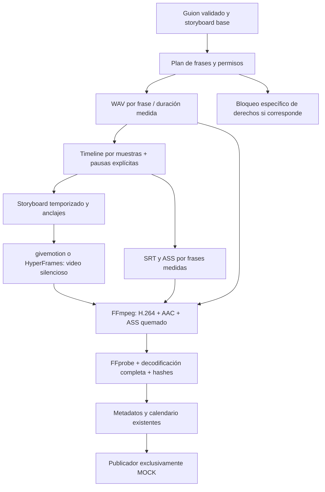

# Fase 4 — narración, sincronización y subtítulos

La misma aplicación Python integra narración opcional en `produce` y `cycle`. givemotion sigue siendo el motor predeterminado; HyperFrames conserva selección explícita y usa el mismo storyboard temporizado. El modo anterior sin audio continúa disponible omitiendo `--narration-config`. No hay otro pipeline ni nuevas dependencias.

Base preservada: `be792f9`, rama `codex/phase4-tts-synchronization`. Los 121 tests anteriores siguen aprobando; la suite completa ejecutada con motores nativos suma **139 tests**. Los resultados audiovisuales anteriores se comprueban contra 13 hashes conservados en `out/phase4/preserved.json`.

Ensayo entregado: costo de oportunidad, **61 s, 1080×1920, 24 FPS, 1.464 fotogramas**, H.264/AAC mono 48 kHz. Son 29 frases con WAV medido y cinco escenas. givemotion: **67,207 s wall, 114,55 s CPU y 1.106,78 MiB RSS simultáneo del árbol**. Composición y QA: 30,883 s wall; síntesis de tonos MOCK: 0,295 s. La reanudación conserva hashes y mtimes del audio, video silencioso, ASS y MP4; el calendario termina SIMULATED_DONE con una sola publicación MOCK. Estas medidas describen el ensayo técnico local, sin evaluar una voz real.

## Contratos y proveedores

- `VoiceManifest` conserva cadena, evidencias, hashes y validación comercial anteriores. Añade permisos técnicos/de prueba, estado documental, procedencia, atribución y restricciones. Un motor libre, una voz comercialmente autorizada y una escucha humana aprobada son decisiones distintas.
- `NarrationConfig`: proveedor, alcance `test`/`commercial`, selección explícita de voz/manifiesto, moneda, pausas, límite editorial, formato y estilo de subtítulos. Los manifiestos relativos a un archivo de configuración se resuelven desde ese archivo.
- `NarrationTimeline`: por frase registra textos editorial/hablado/subtitulado, identidad de escena/segmento padre, WAV original y normalizado, muestras, duración medida, formato, hashes, proveedor, permisos, inicio/final y pausas. Valida cobertura, ausencia de solapamientos y congruencia de muestras/duraciones.
- `VisualStoryboard` continúa independiente de TTS/renderers. Los elementos pueden referenciar `narration_anchor`; se conservan los anclajes originales y se añaden anclajes de frases medidas. Los eventos conservan su posición relativa al retimar la escena. Las cifras y las decisiones editoriales no se duplican en JS.

| Proveedor | Uso | Autorización |
| --- | --- | --- |
| MockTTS existente | Tonos deterministas de 440 Hz; ninguna voz humana | Solo test. Rechaza alcance comercial. |
| PiperTTS existente | Proceso persistente, `synthesize(text,path) -> duration`; se conserva API anterior | Selección explícita y VoiceManifest, hashes de ONNX/config/sidecar, versión exacta, cadena completa y verificada, permisos técnicos/de prueba. Comercial exige además APPROVED y validaciones comerciales previas. |
| ExternalAudio | Copia WAV por segmento; no sintetiza ni supone derechos | Manifiesto del propietario, autorización por alcance, región, licencia, evidencia, transcripción normalizada y SHA reales. |

El resultado enriquecido se registra en `audio_segments.json` y la timeline, conservando la API TTS anterior. Se comprueban todos los datos PCM del WAV, formato y duración. FFmpeg normaliza a PCM s16le/48 kHz sin alterar velocidad; una variación inesperada de duración se rechaza. Se admite mono o estéreo. El renderizador no depende del proveedor TTS.

## Flujo integrado



Etapas persistentes dentro del job: `NARRATION_PLAN`, `AUDIO_SEGMENT_####`, `AUDIO_READY`, `TIMELINE_READY`, `SUBTITLES`, `VIDEO_RENDERED`, `SUBTITLED`, `TECHNICAL_QA_READY`; se mantiene el marcador `RENDER` del MP4 final para las comprobaciones existentes. `produce` finaliza `TECHNICALLY_READY`; el calendario termina `SIMULATED_DONE` solamente tras la conciliación MOCK.

Se priorizan límites de oraciones y cláusulas; los casos extensos conservan los límites tipográficos de dos líneas. Cada frase se genera en su propio WAV. Su duración se mide leyendo las muestras, no se toma del retorno estimado del proveedor. Se añaden pausas configuradas y, al final de cada escena, únicamente el padding mínimo necesario para una frontera exacta de fotograma. La escena se expande o contrae para cubrir todo su audio y sus pausas. El total supera `max_seconds` → `BLOCKED_NARRATION_DURATION`, sin recortar ni acelerar la narración. El límite es explícito y configurable: 90 s por defecto, nunca una aprobación editorial automática.

Se conserva `editorial_text`, se pronuncia `spoken_text` normalizado y se muestra `subtitle_text` con las cifras originales. La normalización cubre ARS/USD, moneda de contexto para `$`, miles/millones, decimales, porcentajes negativos, fechas y siglas financieras. `$` sin moneda es ambiguo y se rechaza. No se inventa la moneda. Los datos numéricos del storyboard permanecen intactos.

Los subtítulos se dividen usando los límites tipográficos existentes **antes** de generar audio; cada cue corresponde a su propio WAV medido. No hay reparto proporcional de palabras ni afirmación de alineación fonética. SRT redondea a milisegundos y ASS a centésimas; los anclajes conservan muestras exactas. No se muestran subtítulos durante las pausas. El ASS usa canvas lógico 1080×1920, fuente DejaVu Sans del proyecto, marfil, contorno marino, centro inferior, margen 400 por defecto y ancho seguro de 820 px. Se validan dos líneas, ancho real, orden y límites temporales/zona segura. La narración larga anterior sobre el canvas se oculta en esta modalidad para evitar duplicarla con los subtítulos. Las posiciones de la interfaz Shorts pueden variar: requieren revisión humana en dispositivo.

FFmpeg compone las pistas completas, sin `-shortest`, sin `atempo` y sin recortar audio. AAC puede redondear su duración a milisegundos; la validación tolera hasta 50 ms, además de exigir el número exacto de frames visuales y decodificación completa.

## Recuperación e invalidación

El lock existente sigue protegiendo cada job. La configuración registra los hashes del código de narración: un cambio de implementación invalida sus etapas; los inputs visuales mantienen su propio fingerprint para reutilizar imágenes equivalentes. Un paquete previo no se modifica tras cambiar esa implementación. `narration_cache` registra firma de entradas y hashes de salidas por etapa; no depende de la posición de una etapa en una lista. Las frases ya completadas sobreviven a un fallo TTS. Un fallo de composición conserva WAV, timeline, subtítulos y `video_silent.mp4`. Un cambio de bytes de audio o autorización invalida su composición; si los tiempos visuales permanecen iguales se reutiliza el render silencioso. Si cambian tiempos, cambian storyboard y render. Los subtítulos dependen de textos/timeline/estilo, evitando reutilización desactualizada.

Antes de empaquetar, `produce` permite revisiones explícitas de guion, storyboard o narración en el mismo job V4, guarda el historial de configuración y recalcula sus dependencias. Motor, dimensiones y configuración base permanecen ligados al trabajo. `cycle` conserva la política anterior de guion asignado a su slot: para revisar el guion por esa entrada se crea un trabajo nuevo. Después de crear el paquete, `metadata.json` y el binding previo a guardar en SQLite hacen inmutables los assets. Una recuperación con otros inputs/hashes se rechaza, nunca sustituye un video ya vinculado. El publicador conserva su cliente exclusivamente MOCK y su reconciliación idempotente.

Subprocess recibe listas de argumentos, entorno limitado y timeouts existentes. Los intentos usan directorios únicos; los MP4 se inspeccionan antes de promoverse con rename. Los errores quedan en eventos/resultados y logs por intento. Las voces Piper siguen requiriendo el sidecar técnico anterior, además de la revisión nueva. No se consultan credenciales ni se activan APIs pagas. Las dependencias opcionales de los motores permanecen aisladas y fijadas.

## Uso

```bash
# Ensayo A, produce sin publicar; la narración es un tono MOCK por frase.
.venv/bin/python -m fabrica.cli produce --mode local \
  --topic 'El costo de oportunidad en las decisiones cotidianas' \
  --script src/fabrica/data/costo_oportunidad.json \
  --storyboard src/fabrica/data/opportunity_storyboard.json \
  --narration-config examples/narration_mock.json \
  --job-id oportunidad-phase4 --output out/phase4/jobs

# Mismo contrato, alternativa explícita:
# añadir --renderer hyperframes

# Ciclo completo MOCK y reconciliación. Crear schedule con fecha del ensayo.
.venv/bin/python -m fabrica.cli cycle --db out/phase4/final_delivery/state.sqlite3 \
  --config out/phase4/schedule.json --output out/phase4/final_delivery \
  --at 2026-11-18T16:00:00+00:00 \
  --script src/fabrica/data/costo_oportunidad.json \
  --storyboard src/fabrica/data/opportunity_storyboard.json \
  --narration-config examples/narration_mock.json --fault uncertain
# Repetir mismos parámetros sin --fault a las 16:02:00+00:00.
```

`examples/narration_piper.json` es una configuración deliberadamente bloqueada hasta aportar voz y manifiesto aprobados. No instala ni descarga modelos. Para grabación del propietario, obtener primero el plan con los mismos guion/storyboard y moneda:

```python
from fabrica.narration_timeline import plan_narration
requests = plan_narration(board, currency="ARS")
```

Los `segment_id` y `spoken_text_sha256` del plan identifican los WAV que debe aportar el propietario. Un manifiesto externo contiene `manifest_id` y `clips`, cada uno con `segment_id`, `path`, `sha256`, `spoken_text_sha256`, `regional_language`, `source`, `license`, `evidence`, `authorized_by`, `test_use_authorized`, `commercial_allowed` y, opcionalmente, `listening_approved`. Rutas relativas: respecto al manifiesto. Guardar configuración `{"provider":"external","authorization_mode":"test","external_manifest":"mi_manifest.json"}`. El propietario declara sus derechos; el sistema registra y verifica la autorización y los bytes, sin inferir permiso comercial a partir de la grabación.

## Evidencias y límites

Resultados reales y mediciones: [reporte local](../out/phase4/report.json), [resumen](../out/phase4/report.md), [visor](../out/phase4/review.html). El visor funciona desde archivo local, con rutas relativas y datos embebidos, sin dependencias externas. Se verificaron seis controles en Chromium local (carga, rótulo MOCK, reproducción/caption activo, pausa, búsqueda y reinicio), sin errores JavaScript: `out/phase4/viewer-smoke.json`. Windows no se ejercitó directamente; se entregan las rutas UNC y comandos para revisión allí. Presenta el MP4 con audio y subtítulos quemados, las frases temporizadas y enlaces a los intermedios.

El job conserva `narration_request.json`, `audio_segments.json`, WAV por frase, `narration.wav`, `narration_timeline.json`, `base_storyboard.json`, `visual_storyboard.json`, `storyboard.json`, `video_silent.mp4`, `subtitles.srt`, `subtitles.ass`, `subtitle_validation.json`, `final.mp4`, `qa.json`, `manifest.json`, `render.json`, `result.json`, metadatos y publicación simulada. FFprobe, decode y framemd5 quedan bajo los intentos/validaciones. El archivo principal no se etiqueta listo para publicación.

```bash
.venv/bin/ruff check .
FABRICA_NATIVE_TESTS=1 .venv/bin/python -m pytest -q
```

Cobertura nueva: WAV íntegro/truncado, normalización/corpus/cifras, selección y autorización explícitas, región/hash/versión, audio externo, muestras y límites, retiming/anclajes, safe zones, recuperación TTS y composición, invalidación de audio conservando imágenes con ambos motores, calendario, paquete inmutable y una sola publicación MOCK. Los tests nativos requieren runtimes locales provisionados y Chromium con loopback; no se sustituyen por MP4 de otro motor.

Dependencias preservadas: givemotion 0.1.6, HyperFrames 0.9.59, Node 22.16.0, Chromium 157.0.8103.78 y Piper opcional 1.8.0. Las versiones/hashes efectivos de FFmpeg, navegador, Node y lockfiles quedan en render.json y el reporte. Sin nuevas instalaciones. El tiempo TTS MOCK mide generación de tonos; no predice rendimiento de una voz real. Las métricas nativas incluyen CPU y RSS del árbol; el máximo de hijos de composición está etiquetado como high-water mark acumulado, no como RAM aislada de esa etapa. Costos de API medidos: cero llamadas/cero USD. No se midieron electricidad ni amortización de hardware.

Prueba B: **BLOCKED_VOICE_RIGHTS**, documentada en [auditoría actualizada](PHASE4_VOICE_AUDIT.md). Los tonos originales de los tests ExternalAudio prueban el contrato técnico y no cuentan como narración real autorizada. Pendientes para publicar: voz/grabación es-419 con cadena/permiso suficientes y hashes exactos, revisión de contenido, derechos, pronunciación y ritmo; revisión humana de subtítulos/transiciones y prueba en dispositivo. Un alineador por palabra sigue siendo opcional y deberá justificar su beneficio. La publicación real permanece deshabilitada.

Para regenerar el visor/reporte desde un job terminado, sin sintetizar ni renderizar:

```bash
.venv/bin/python tools/phase4_review.py out/phase4/final_delivery/jobs/slot-ad594e9667035620906ebaed057a9329 --output out/phase4
# Desde WSL, abrir todos los entregables en Windows:
explorer.exe "$(wslpath -w "$PWD/out/phase4")"
# PowerShell:
# Start-Process '\\wsl.localhost\Ubuntu-24.04\home\devvideo\proyectos\fabrica_de_videos\out\phase4\review.html'
```

`tools/phase4_review.py` solo inspecciona el job ya completado, comprueba hashes y genera evidencias/visor. No crea trabajos ni sustituye el pipeline.
